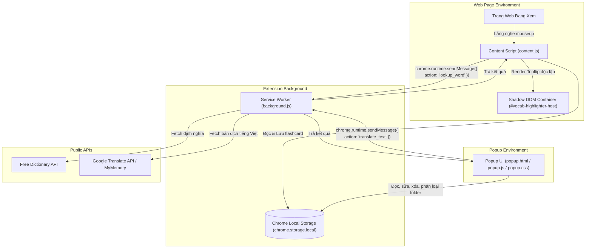
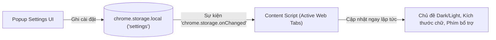
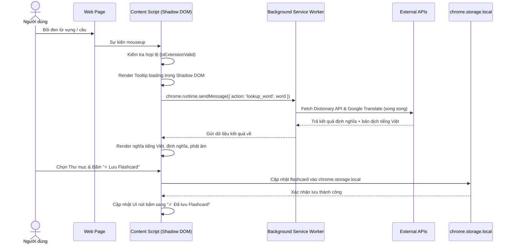

# Kiến Trúc Hệ Thống (Architecture & Technical Design)
# Tiện Ích Mở Rộng: Vocab Highlighter

## 1. Tổng Quan Kiến Trúc (Manifest V3)

Vocab Highlighter tuân thủ nghiêm ngặt mô hình kiến trúc **Google Chrome Extensions Manifest V3**, chia hệ thống thành 3 môi trường thực thi (Execution Environments) độc lập và bảo mật:



---

## 2. Các Thành Phần Cốt Lõi

### 2.1. Background Service Worker (`background/background.js`)
* **Vai trò**: Trung tâm điều phối mạng và các tác vụ ngầm.
* **Nhiệm vụ chính**:
  1. **Proxy vượt rào CSP & CORS**: Kể từ Chrome 111+, Content Script bị ràng buộc bởi CSP của trang web mục tiêu (nhiều trang chặn gọi `fetch()` ra bên ngoài). Service Worker đóng vai trò trung gian thực hiện các request `fetch()` đến Free Dictionary API và Google Translate API mà không bị chặn.
  2. **Xử lý dữ liệu song song (`Promise.allSettled`)**: Gọi đồng thời API từ điển Anh-Anh và API dịch tiếng Việt để tối ưu thời gian phản hồi.
  3. **Tự động nhận diện văn bản**: Phân biệt từ vựng đơn lẻ hay đoạn văn bản dài để định tuyến API phù hợp.
  4. **Khởi tạo dữ liệu hệ thống**: Tạo thư mục mặc định `"Mặc định"` ngay khi cài đặt extension (`chrome.runtime.onInstalled`).

### 2.2. Content Script & Shadow DOM (`content/content.js`, `content/content.css`)
* **Vai trò**: Tương tác trực tiếp với giao diện người dùng trên trang web.
* **Kỹ thuật Shadow DOM**:
  ```mermaid
  graph LR
      PageDOM["Trang Web DOM"] --> Host["#vocab-highlighter-host"]
      Host --> ShadowRoot["#shadow-root (open)"]
      ShadowRoot --> ScopedCSS["<style> Cô lập </style>"]
      ShadowRoot --> TooltipUI[".vh-tooltip"]
  ```
  * Tạo một Shadow Root với chế độ `open`.
  * Toàn bộ CSS của Tooltip được nhúng trực tiếp bên trong Shadow Root. CSS của trang web ngoài (kể cả rule `!important`) không thể làm vỡ giao diện của Extension.
* **Tính toán vị trí thông minh**:
  * Đọc `Selection.getRangeAt(0).getBoundingClientRect()`.
  * So khớp với `window.innerWidth`, `window.innerHeight`, `window.scrollX`, `window.scrollY` để dịch chuyển tooltip tránh tràn mép màn hình.
* **Cơ chế âm thanh lai (Hybrid Audio Player)**:
  * Ưu tiên 1: Sử dụng URL file mp3 phát âm bản xứ từ Free Dictionary API (`new Audio(url).play()`).
  * Ưu tiên 2: Tự động fallback sang Web Speech API (`window.speechSynthesis`) khi không có file âm thanh hoặc kết nối âm thanh bị lỗi.

### 2.3. Popup Application (`popup/popup.html`, `popup/popup.css`, `popup/popup.js`)
* **Vai trò**: Ứng dụng quản trị, ôn tập và cấu hình cá nhân.
* **Kiến trúc SPA (Single Page Application)** dạng mini gồm 4 tab chức năng:
  1. **Tab Từ vựng**: Danh sách từ đã lưu, tìm kiếm real-time, nút sửa/xóa, bộ lọc theo Folder, nút xuất file Excel.
  2. **Tab Flashcard**: Chế độ ôn tập với hiệu ứng xoay lật 3D (`transform-style: preserve-3d; transition: transform 0.45s`).
  3. **Tab Dịch đoạn văn**: Công cụ dịch nhanh hai chiều với khung nhập văn bản, đếm ký tự và nút lưu thành flashcard.
  4. **Tab Cài đặt**: Trung tâm quản lý hành vi kích hoạt (bật/tắt, blacklist domain, trigger key Alt/Ctrl), giọng đọc & tốc độ âm thanh, ngôn ngữ dịch đích (7 ngôn ngữ), giao diện Dark/Light mode, cỡ chữ, và hệ thống sao lưu/phục hồi JSON.

### 2.4. Cơ Chế Đồng Bộ Cài Đặt Thời Gian Thực (Live Settings Synchronization)

* **Phản ứng tức thì (Instant Reactivity)**: Content Script lắng nghe sự kiện `chrome.storage.onChanged`. Khi người dùng thay đổi bất kỳ cấu hình nào trong Popup (ví dụ đổi phím kích hoạt sang `Alt`, bật Dark Mode, đổi ngôn ngữ dịch), các tab đang mở áp dụng ngay lập tức mà không cần F5 tải lại trang.

---

## 3. Sơ Đồ Luồng Hoạt Động (Sequence Diagram)

### Luồng Tra Từ & Lưu Flashcard Khi Bôi Đen:


---

## 4. Cơ Chế Tự Phục Hồi (Context Invalidation Handling)

Khi extension được Reload tại `chrome://extensions`, token của context cũ bị Chrome vô hiệu hóa:
1. `content.js` luôn thực hiện hàm kiểm tra:
   ```javascript
   function isExtensionValid() {
     try {
       return Boolean(typeof chrome !== "undefined" && chrome.runtime && chrome.runtime.id);
     } catch (e) {
       return false;
     }
   }
   ```
2. Nếu `isExtensionValid() === false` hoặc khi `sendMessage` trả về lỗi chứa chuỗi `"invalidated"`, extension sẽ:
   - Chặn các lệnh gọi hàm của `chrome.*` tiếp theo để không gây văng unhandled rejection.
   - Hiển thị trực tiếp hộp thoại hướng dẫn thân thiện: *"Tiện ích vừa được cập nhật. Vui lòng tải lại trang (F5)"* kèm nút bấm `window.location.reload()`.

---

## 5. Xuất Dữ Liệu Excel Chuẩn UTF-8 BOM

Để Microsoft Excel trên hệ điều hành Windows hiển thị chính xác các ký tự tiếng Việt có dấu mà không bị lỗi mã hóa (mojibake):
* Dữ liệu CSV được nối chuỗi kèm ký tự **Byte Order Mark `\uFEFF`** ở đầu file:
  ```javascript
  const csvContent = "\uFEFF" + [headers.join(","), ...rows].join("\r\n");
  const blob = new Blob([csvContent], { type: "text/csv;charset=utf-8;" });
  ```
* Toàn bộ các trường dữ liệu có chứa dấu phẩy, dấu nháy kép hoặc xuống dòng đều được bao bọc trong cặp nháy kép và escape theo chuẩn RFC 4180.

